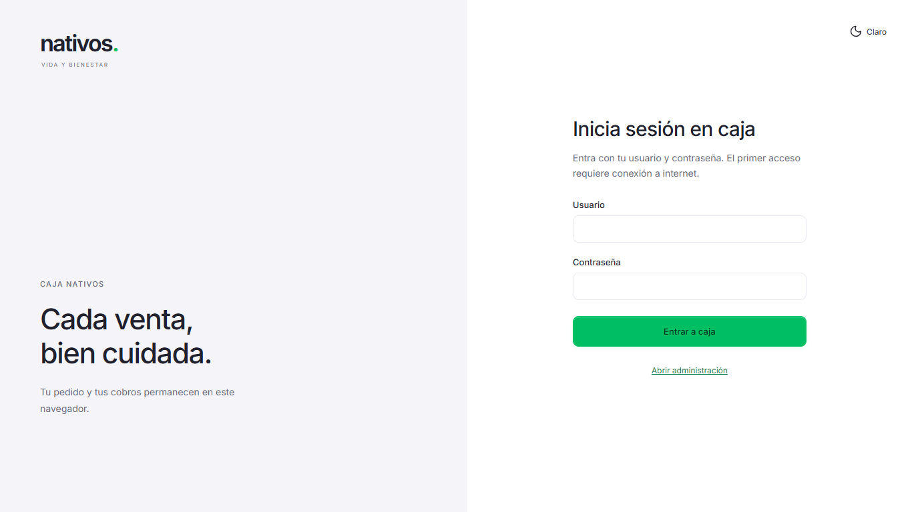
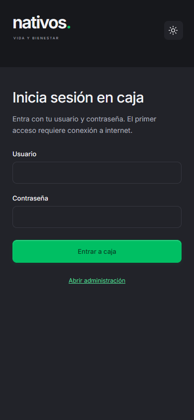
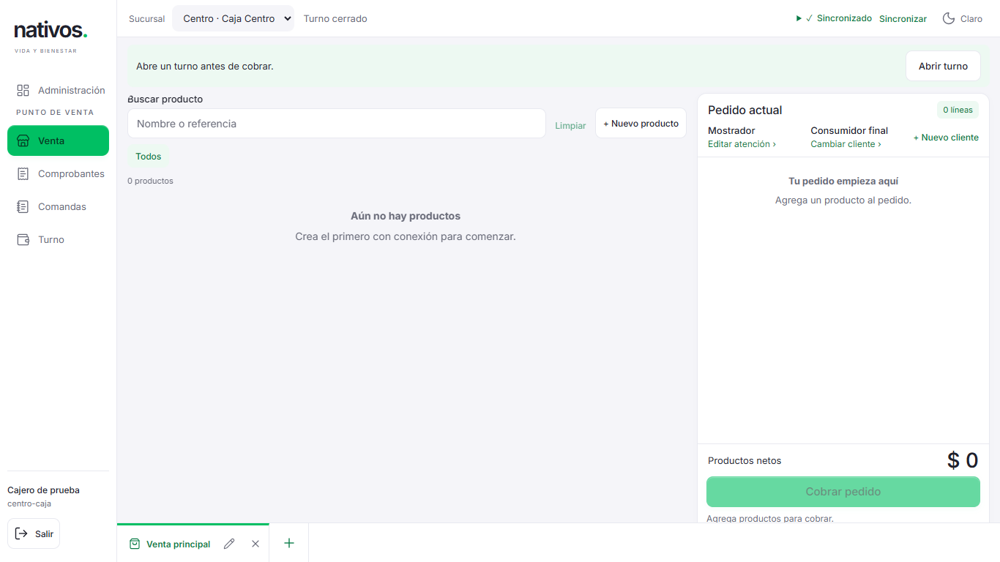

# Caja con usuario y contraseña — 01-11-2026

Estado: publicado en `nativos-web/production`, despliegue `e85d4dfa-b52c-4335-90d0-aecf63d308fe`, commit `278a5f4`. Salud y huellas del cliente verificadas. El rechazo de un token antiguo en Centro tiene una [corrección de continuación](../caja-centro-revalidation-2026-11-01.md).

## Solicitud y alcance

El usuario elimina la activación inicial por el dueño y pide entrar únicamente con usuario y contraseña, sin restricción por navegador. REQ/AC-018-12 a 14 sustituyen esa parte de AC-018-09. Checkout `fix/caja-password-access`, basado en `origin/main` / `8d6e0cd`; excluye los cambios de WhatsApp que están en staging.

## Resultado

- Una cuenta activa entra directamente desde un navegador nuevo o privado a su caja autorizada. El dueño también entra sin formulario de activación. Administración prepara el mismo acceso al validar la contraseña.
- El servidor exige sesión válida, equipo activo y permiso de lectura en la sucursal. Conserva los permisos de cobro, devolución, administración y continuidad de turnos.
- El alta automática conserva tokens, cursores, pendientes y perfiles anteriores. Un identificador conocido no permite reemplazar una instalación ajena. Una respuesta de preparación perdida puede recuperarse sin borrar datos ni reactivar instalaciones revocadas.
- Se mantienen el verificador offline, la vinculación entre contraseña y actor, los siete días de autorización, los cambios de sucursal por cuenta y el traslado histórico local explícito cuando existe una caja anterior.
- Sin cambios de esquema de base de datos, inventario, usuarios comerciales o operaciones históricas.

## Verificación

- `npm.cmd run check`: TypeScript, 75/75 pruebas unitarias, 84/84 pruebas de integración contra PostgreSQL real y compilación aprobados. Registro local: `.local/password-access-check.log`.
- `npm.cmd run test:e2e`: 2/2 recorridos aprobados en Edge, 6,5 minutos. Incluyen cajero como primer usuario en dos contextos vacíos, dueño directo, sucursales por cuenta, recuperación offline, ventas, continuidad/cierre de turnos, permisos, traslado histórico y administración. Registro: `.local/password-access-e2e.log`.
- Después de extender la recuperación de respuesta perdida al formulario local de caja histórica, se repitieron las 3 pruebas afectadas de motor/identidad y la comprobación TypeScript, todas aprobadas. La compilación final incluye ese ajuste. Registros: `.local/password-access-final-tests.log` y `.local/password-access-final-typecheck.log`.
- Playwright CLI: navegador vacío sin sesión del dueño, formulario con solo usuario y contraseña, envío por teclado y acceso directo de `ui-cajero1` a Centro. Se revisaron escritorio 1366×768 y móvil 390×844, en claro y oscuro. Cuenta y base sintéticas aisladas; el servidor auxiliar se detuvo al terminar.
- Se conservaron las evidencias históricas que la suite de administración regenera. Las capturas propias de este incremento se incluyen abajo.

## Capturas revisadas

## Límites operativos

El primer acceso de un navegador nuevo necesita internet para validar credenciales y descargar Caja. El trabajo sin conexión requiere acceso previo en ese perfil. Los pedidos y pendientes no sincronizados permanecen en el navegador donde se crearon; el modo privado elimina su almacenamiento al terminar la sesión. Este cambio no realiza ventas, abre/cierra turnos comerciales ni publica por sí mismo en Railway.
