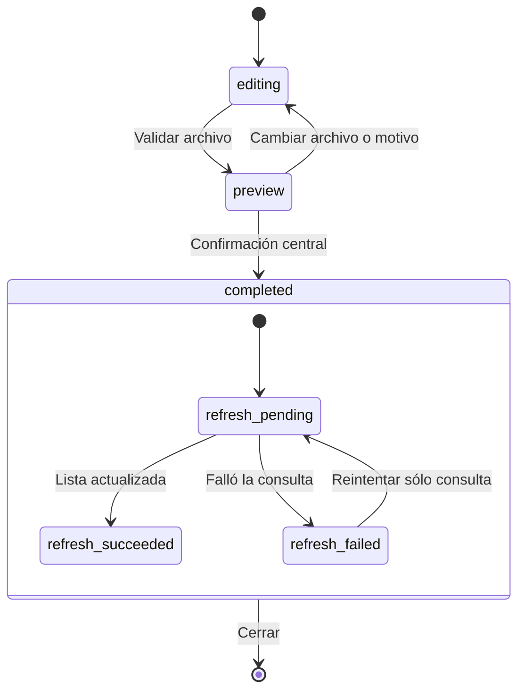

# Máquinas de estados de Nativos

Inspección del 09-11-2026 sobre `software-nativos`, base `131a5b6`. El mapa reúne **42 familias**, agrupando instancias equivalentes y regiones independientes. Es un inventario estático del código inspeccionado: no una garantía matemática de que ningún flujo futuro pueda ser implícito. Las transiciones son un resumen observable; el dominio, sus guardas y los contratos versionados siguen siendo la autoridad.

## Decisión

Hacer explícitos los estados donde hay beneficio simultáneo y comprobable para UX, DX y AX: envío de formularios, importación Excel confirmada y evidencia de entrega WhatsApp. Mantener los dominios de cobro, canje, turnos y sincronización en sus límites transaccionales actuales, protegidos por regresiones. No añadir una dependencia global ni convertir campos de edición, cantidades o filtros en máquinas artificiales.

| Cambio | UX | DX | AX |
| --- | --- | --- | --- |
| Operación única de formulario | Doble envío no inicia otra operación; error corregible y ocupado accesible | Estado discriminado y exclusión sincrónica compartidos | Un contrato de operación con estados y pruebas reproducibles |
| Importación con resultado irreversible | Lote guardado sigue confirmado aunque falle actualizar la lista | Éxito central separado de consulta posterior | Se puede decidir reintentar la consulta conservando importId, sin otra escritura |
| Entrega según origen de evidencia | Seguimiento fiel; fallo definitivo no vuelve a reintento por HTTP tardío | Enum, etiquetas y transición de dominio compartidos | Estados aceptados por API y reglas de recuperación consultables en una fuente |
| Inventario y auditoría local | Menos regresiones al cambiar flujos | Mapa de límites y pruebas existentes | JSON con IDs estables, disparadores, guardas, persistencia y archivos reales |

## Inventario

El detalle está en [state-machines.json](state-machines.json). Cada familia incluye estados, transiciones, guardas, persistencia, archivos y pruebas existentes. Una referencia a una prueba indica protección parcial o específica; no acredita que cubra todas las combinaciones del grafo.

| ID estable | Familia | Representación | Entrada principal |
| --- | --- | --- | --- |
| `bootstrap` | Configuración e inicio del sitio | Implícita | [web/main.tsx](../web/main.tsx) |
| `sessions` | Sesiones, identidad y revocación humana | Implícita | [src/server/security.ts](../src/server/security.ts) |
| `login-throttle` | Bloqueo temporal de acceso | Implícita | [src/server/app.ts](../src/server/app.ts) |
| `offline-access` | Autorización offline y confianza del reloj | Implícita | [src/authorization.ts](../src/authorization.ts) |
| `browser-enrollment` | Activación de navegador y contraseña offline | Implícita | [web/Pos.tsx](../web/Pos.tsx) |
| `terminal-profiles` | Selección y cambio de caja por cuenta | Implícita | [web/offline/engine.ts](../web/offline/engine.ts) |
| `shifts` | Turno, continuación compartida y cierre remoto | Implícita | [web/offline/engine.ts](../web/offline/engine.ts) |
| `orders` | Ciclo del pedido y cobro dividido | Implícita | [src/orders-domain.ts](../src/orders-domain.ts) |
| `preparation` | Preparación y cancelación de líneas | Implícita | [src/orders-domain.ts](../src/orders-domain.ts) |
| `order-tabs` | Selección, cierre y numeración de ventas abiertas | Explícita | [web/order-navigation.ts](../web/order-navigation.ts) |
| `checkout` | Preparación y confirmación de cobro | Implícita | [web/OrderForms.tsx](../web/OrderForms.tsx) |
| `refunds` | Saldo y aplicación de devoluciones | Implícita | [src/orders-domain.ts](../src/orders-domain.ts) |
| `command-idempotency` | Comando idempotente y conflicto de revisión | Implícita | [web/Catalog.tsx](../web/Catalog.tsx) |
| `outbox` | Sincronización, acuse y conciliación | Explícita | [src/sync.ts](../src/sync.ts) |
| `redemption` | Intención durable y cancelación de canje | Implícita | [web/offline/engine.ts](../web/offline/engine.ts) |
| `catalog-lifecycle` | Catálogo operativo y archivo reversible | Implícita | [src/server/catalog-api.ts](../src/server/catalog-api.ts) |
| `recipe-versions` | Borrador, receta vigente y habilitación de preparados | Explícita | [src/catalog.ts](../src/catalog.ts) |
| `initial-inventory` | Inventario inicial y reversión causal | Implícita | [src/server/catalog-api.ts](../src/server/catalog-api.ts) |
| `cost-knowledge` | Costo conocido, pendiente y conciliación | Implícita | [src/server/catalog-api.ts](../src/server/catalog-api.ts) |
| `transfers` | Despacho y recepción parcial de traslado | Implícita | [src/server/catalog-api.ts](../src/server/catalog-api.ts) |
| `inventory-commits` | Compras pagadas, conteos y consumo interno | Implícita | [web/Purchases.tsx](../web/Purchases.tsx) |
| `loyalty-membership` | Inscripción, saldo de puntos y reglas versionadas | Implícita | [src/loyalty.ts](../src/loyalty.ts) |
| `sellers-commissions` | Vendedor, comisión y atribución histórica | Implícita | [src/sellers.ts](../src/sellers.ts) |
| `agent-credentials` | Credenciales de agente y revelación única | Implícita | [src/server/agent-api.ts](../src/server/agent-api.ts) |
| `agent-imports` | Vista previa y confirmación de lotes de agente | Implícita | [src/server/agent-api.ts](../src/server/agent-api.ts) |
| `excel-server` | Vista previa Excel con caducidad e idempotencia | Implícita | [src/server/excel-import-api.ts](../src/server/excel-import-api.ts) |
| `excel-ui` | Importación Excel y refresco posterior al commit | Explícita | [web/CatalogImport.tsx](../web/CatalogImport.tsx) |
| `notification-mode` | Elegibilidad de reporte para envío | Explícita | [src/server/notifications-api.ts](../src/server/notifications-api.ts) |
| `notification-delivery` | Cola y evidencia de entrega WhatsApp | Explícita | [src/notification-state.ts](../src/notification-state.ts) |
| `notification-scheduler` | Evaluación diaria y apagado del despachador | Implícita | [src/server/notifications-api.ts](../src/server/notifications-api.ts) |
| `backups` | Creación, integridad y ensayo aislado de respaldo | Implícita | [src/server/backup-api.ts](../src/server/backup-api.ts) |
| `browser-storage` | Agregado cifrado, exclusión entre pestañas y commit | Implícita | [web/offline/storage.ts](../web/offline/storage.ts) |
| `service-worker` | Instalación, espera, activación y precarga offline | Implícita | [src/service-worker.ts](../src/service-worker.ts) |
| `legacy-transfer` | Traslado único de caja histórica a navegador | Histórica | [src/server/local-transition.ts](../src/server/local-transition.ts) |
| `ui-operation` | Operación compartida de formulario | Explícita | [src/async-operation.ts](../src/async-operation.ts) |
| `remote-queries` | Consultas, paginación y descarte de respuestas obsoletas | Implícita | [web/Reports.tsx](../web/Reports.tsx) |
| `ui-dialogs` | Diálogos y contexto de edición | Implícita | [web/components.tsx](../web/components.tsx) |
| `ui-navigation` | Navegación, panel móvil y preferencias | Implícita | [web/main.tsx](../web/main.tsx) |
| `runtime-migrations` | Arranque, migraciones y cierre de servidor | Implícita | [src/server/db.ts](../src/server/db.ts) |
| `connectivity` | Conectividad observada y recuperación de red | Implícita | [web/offline/engine.ts](../web/offline/engine.ts) |
| `stock-thresholds` | Existencias negativas y umbrales de mínimos | Implícita | [src/server/notification-reports.ts](../src/server/notification-reports.ts) |
| `exports-printing` | Exportación y solicitud de impresión | Implícita | [src/server/xlsx.ts](../src/server/xlsx.ts) |

## Lectura de las regiones

- **Identidad:** sesión central, verificador local, concesión offline, reloj, permisos y activación son regiones separadas. Estar online no implica estar autorizado; una cookie nueva no puede cambiar el actor de la contraseña local.
- **Caja:** pedido, preparación, cobro, turno y sincronización no forman un único estado lineal. Una venta puede estar confirmada localmente y pendiente en central. Un turno compartido tiene membresías, y un cierre remoto puede conocerse antes de recibir su detalle autorizado.
- **Dinero y puntos:** importe disponible para devolver y saldo de puntos son estados derivados del libro inmutable. Nunca se sustituyen por un booleano `paid`/`refunded` ni se recalculan con reglas nuevas.
- **Importación:** la vista previa del agente es un fingerprint sin borrador persistido; Excel tiene una vista previa central con TTL. En ambos casos la confirmación revalida y es idempotente. Actualizar una lista es otra operación.
- **WhatsApp:** modo de reporte, elegibilidad, cola, intento y evidencia de entrega son regiones distintas. `preview` nunca cambia a `live`. No se usa un orden numérico simple para todas las respuestas: transporte y callback tienen autoridad diferente.
- **Interfaz:** los controles locales y las consultas remotas se repiten por módulo. El inventario agrupa estas instancias; no multiplica la cuenta por cada `useState`. Campos como búsqueda, cantidad o motivo son contexto, salvo que disparen una transición del flujo.

## Ejemplo implementado: confirmación y consulta separadas



`completed` conserva el resultado y el ID central durante todo el refresco. La máquina de operación compartida controla la solicitud en curso y rechaza eventos duplicados antes de ceder ejecución. Cerrar el diálogo no revierte la importación.

## Riesgos conservados y siguiente cambio razonable

| Área | Hallazgo | Decisión en este incremento |
| --- | --- | --- |
| Diálogos de Caja | `modal`, `line`, `cancelId`, `receipt` y otros datos viven en estados separados; pueden representar combinaciones no deseadas | Inventariar y conservar; sustituirlos por una unión necesita pruebas de cada diálogo, recuperación, impresión y foco |
| Cierre de formularios mientras envían | La importación bloquea cierre explícitamente; otros diálogos pueden cerrarse mientras sigue una solicitud | Mantener el comportamiento actual y documentarlo; no cambiar Escape/cierre de todos los módulos sin definir recuperación de un resultado tardío |
| Consultas remotas | Informes/WhatsApp usan generaciones; otras listas tienen guardas diferentes | Conservar claves de sucursal y cancelaciones existentes; una normalización global de cargas/paginación queda fuera del cambio acotado |
| Cola offline | Algunas recuperaciones específicas cambian estado fuera de `sync.transition` | Conservar guardas de secuencia/inventario/reloj y acuse exacto; no convertir conciliación en reintento general |
| Compatibilidad | El adaptador SQLite/Electron replica ciclos del dominio por motivos históricos | Preservar protocolos y pruebas; no añadir producto nuevo al adaptador |

Estas observaciones son prioridades de mantenimiento, no afirmaciones de un fallo comercial demostrado. Las tres correcciones implementadas sí tienen casos concretos de regresión en la spec 021.

## Uso para desarrollo y agentes

```powershell
npm.cmd run audit:states
node scripts/audit-state-machines.ts --json
npm.cmd run check
npm.cmd run test:e2e
```

El comando verifica IDs únicos, estados/transiciones y que existan los archivos de implementación/prueba. `check` lo ejecuta antes de tipos y pruebas. No infiere estados nuevos ni demuestra cobertura exhaustiva automáticamente: al añadir un flujo, actualizar su familia o crear una con evidencia. El JSON es la fuente única del inventario; esta tabla es su índice humano. No requiere credenciales, red ni datos comerciales.

Diseño/aceptación: [spec 021](../specs/021-state-machines/spec.md). Resultados de ejecución: [evidencia](evidence/state-machines-2026-11-09.md).
